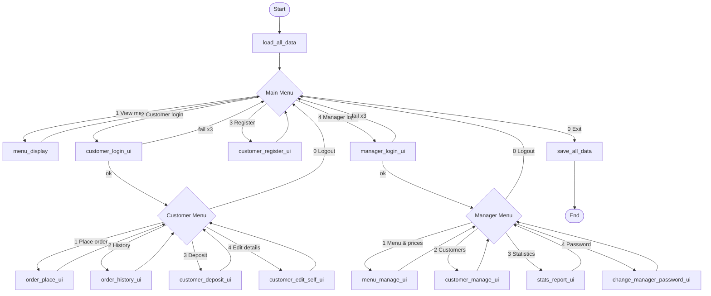
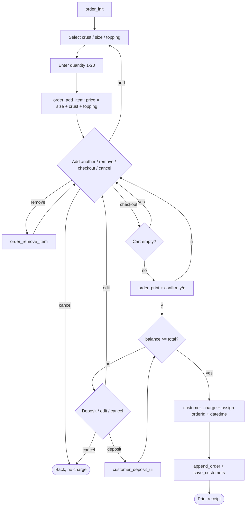
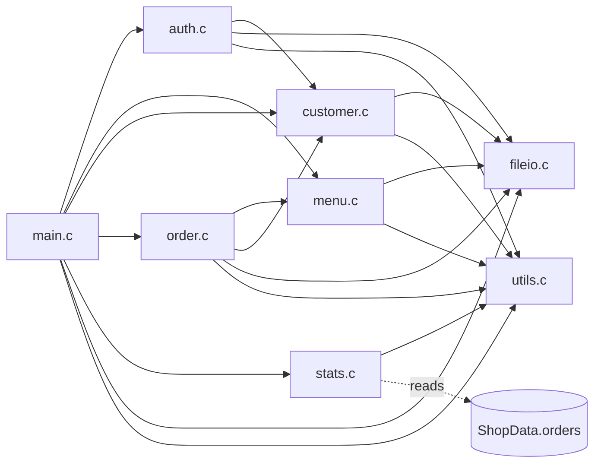

> 说明：本草稿是写报告和分工用的**起点**。所有标注 **【提议】** 的数字、规则都只是建议默认值，需要全组在第一次组会上确认或修改。确认后，第 1、2 节可以几乎直接放进报告的 *Problem Specification* 和 *Analysis* 部分（翻译成英文即可）。配套的可编译代码骨架见 `skeleton.zip`。

# 0. 作业关键信息速查

| 项目 | 内容 |
|---|---|
| 题目 | Pizza Ordering System（店内点餐终端，C 语言控制台程序） |
| 占比 | 课程总分 15% |
| 截止 | **2026-12-13 23:59**（北京时间） |
| 人数 | 严格 5 人，组长一人提交一个 `.zip`/`.rar` |
| 提交物 | PDF 报告（含封面：全员姓名+学号）、全部 `.c/.h`、最终 `.exe`、数据文件、使用手册 (manual)、全员签名的 Contribution Form |
| 评分 | 文档 50%（Overall Quality / Problem Specification / Analysis / Algorithm Design / Testing 各 10%）；代码 50%（Implementation & coding style 40%，Robustness 10%） |
| 硬性要求 | top-down 设计、模块化、每个模块可独立测试、**每个成员都要写代码**、源代码要有注释、测试账号密码要列表、可能被叫去口头答辩 |
| 评分原则 | 少做几个功能但完全不崩溃 > 功能全但有 bug；缺功能按比例扣分 |

# 1. Problem Specification（报告可用草稿）

一家新开的比萨店需要一套运行在店内终端上的点餐软件。本项目使用 C 语言开发一个基于控制台（命令行）的 **Pizza Ordering System**，为两类用户提供服务：**顾客（Customer Self Service）** 和 **店长（Shop Manager）**。

系统应提供以下功能：

1. **菜单与定价**：店内菜单由三类选项组成——饼底类型（Crust，如 Hand Tossed、Thin and Crispy）、尺寸（Size，如 10"、12"、14"、16"）和口味（Topping，如 Margherita、Hawaiian、BBQ Chicken、Supreme）。顾客通过组合"饼底 + 尺寸 + 口味"定制一个比萨，系统根据这三项自动计算价格。
2. **顾客账户**：每个顾客拥有一个由系统自动分配、唯一的账号（account number）。账户信息包括姓名、电话、登录密码、可用余额和订单历史。账户采用预充值方式，下单时从余额中扣款。
3. **顾客自助服务**：顾客可以注册账户，用账号和密码登录，然后下单（一次订单可包含多个比萨）、查看订单历史、向账户充值，以及修改自己的电话和密码。
4. **店长管理**：店长通过用户名和密码登录，可以编辑比萨菜单（增加、改名、上下架、删除选项）、设置和修改价格、增加/删除/编辑顾客信息，以及查看比萨销售统计（总营业额、销量、按饼底/尺寸/口味的分类统计、最畅销组合、按日期统计）。
5. **数据持久化**：菜单、顾客、订单和店长账户保存在文本数据文件中，程序启动时读取、数据变化时保存，程序重启后数据不丢失。
6. **健壮性**：对所有用户输入进行校验。非法输入（如字母代替数字、负数、超出范围、超长字符串、空输入）不能导致程序崩溃或产生错误数据，而是给出提示并要求重新输入。

**输入**：键盘输入的菜单选择、账号、密码、金额、比萨选项和数量等；启动时读取的数据文件。
**输出**：屏幕上的菜单、价格、订单确认单、订单历史、余额和统计报表；更新后的数据文件。

# 2. Analysis（需求澄清与设计决策）

作业的需求故意写得很模糊，下表列出需要小组决定的问题和建议默认值。每个决策都应在报告 Analysis 部分写成"需求原文 → 我们的解释 → 理由"。

## 2.1 菜单与定价

**【提议】定价公式（加法模型）：**

```
单个比萨价格 = 尺寸基础价 (Size base price)
             + 饼底附加费 (Crust surcharge)
             + 口味附加费 (Topping surcharge)
订单行金额   = 单价 × 数量
订单总额     = 所有订单行金额之和
```

理由：公式简单、容易验证和测试；店长只需改某一项价格，所有组合的价格就会自动更新，满足"Set/alter charges"的要求，也方便以后增加新选项。

**【提议】默认菜单（示例价格，单位：元，程序内部以"分"存储）：**

| 类型 | ID | 名称 | 价格 |
|---|---|---|---|
| Size | 1 | 10 inch | 39.00（基础价） |
| Size | 2 | 12 inch | 49.00 |
| Size | 3 | 14 inch | 59.00 |
| Size | 4 | 16 inch | 69.00 |
| Crust | 1 | Hand Tossed | +0.00 |
| Crust | 2 | Thin and Crispy | +5.00 |
| Crust | 3 | Stuffed Crust | +12.00 |
| Topping | 1 | Margherita | +0.00 |
| Topping | 2 | Hawaiian | +8.00 |
| Topping | 3 | BBQ Chicken | +12.00 |
| Topping | 4 | Supreme | +15.00 |

例：12 inch + Thin and Crispy + Supreme = 49 + 5 + 15 = **69.00 元**。

其他菜单规则【提议】：

- 金额一律用整数"分"（`typedef long Money`）存储和计算，避免 `float` 舍入误差；显示时格式化为 `xx.xx`。
- 每个选项有唯一 `id`，删除后 `id` 不再复用。
- 店长可以"下架"（`available = 0`）某个选项：顾客看不到、不能点，但历史订单和统计不受影响。推荐用下架代替删除；只有当某类选项多于 1 个时才允许删除，每类至少保留 1 个可点选项。
- 选项名称 1–31 个字符，不能为空，不能含 `|`（数据文件分隔符），同类中不能重名（不区分大小写）。
- 价格范围：尺寸基础价 0.01–1000.00 元；附加费 0.00–1000.00 元；最多两位小数。
- 容量上限：饼底 10 种、尺寸 10 种、口味 20 种。
- *（可选扩展）* 套餐、优惠券、会员折扣——时间够再做，不做也要在报告里写"不在范围内"。

## 2.2 顾客账户

| 问题 | 【提议】决定 |
|---|---|
| 账号规则 | 系统自动分配 6 位数账号，从 `100001` 起递增，永不复用（删除后也不复用） |
| 必填信息 | 姓名（1–31 字符，不含 “\|”）、电话（5–15 位纯数字）、密码（6–16 个可见字符，不含空格和 “\|”） |
| 谁能注册 | 顾客在主菜单自助注册，店长也可以在后台添加顾客（两种方式调用同一个 `customer_add()`） |
| 初始余额 | 0.00；注册后可立即充值 |
| 电话重复 | 允许或禁止由组会决定；【提议】禁止重复，便于店长按电话查找 |
| 删除账户 | **软删除**：`active = 0`，不能再登录，也不显示在列表中，但订单记录保留，统计仍然准确；有余额时删除前需店长确认（提示"线下退款"） |
| 顾客可改的信息 | 电话、密码（需先输入旧密码）；姓名由店长修改 |
| 店长可改的信息 | 姓名、电话、重置密码；**不能**直接改余额（防止作弊，余额只通过充值和下单变化）；【可讨论】是否允许店长做"余额调整" |
| 容量 | 最多 500 个账户 |
| 订单历史 | 不存在 Customer 结构里，而是按 `accountNo` 从订单表查询（避免数据重复） |

## 2.3 登录

| 问题 | 【提议】决定 |
|---|---|
| 顾客登录 | 输入账号 + 密码 |
| 店长登录 | 用户名 + 密码，默认 `admin / admin123`，保存在 `manager.txt`，店长可修改密码 |
| 失败次数 | 每次登录最多尝试 3 次，失败后返回主菜单 |
| 错误提示 | 统一提示 "Invalid account or password"，不透露是账号还是密码错 |
| 密码存储 | 课程层面可明文存储；*（可选加分）* 用简单哈希（如 djb2）存储，在报告里说明 |
| 输入 `0` | 在任何输入提示下输入 `0` 表示取消并返回上一级 |

## 2.4 充值 (Deposit)

- 单次充值金额：**1.00–5000.00 元**，最多两位小数，必须为正数。
- 余额上限：**99,999.99 元**，超过则拒绝本次充值。
- 充值前显示金额并要求确认 (y/n)，成功后显示新余额并立即保存文件。
- *（可选）* 记录充值流水（`deposits.txt`），可用于统计。

## 2.5 下单流程

1. 顾客登录后选择 "Place an order"，系统显示可点的菜单。
2. 依次选择 Crust → Size → Topping（用编号），再输入数量（1–20）。
3. 显示该比萨单价和小计，加入"购物车"（当前订单）。
4. 可以继续添加，最多 10 行；也可以删除某一行，或清空购物车。
5. 结账：显示完整订单（每行明细 + 总额 + 当前余额 + 结账后余额），要求确认 (y/n)。
6. **余额不足时**：提示差额，提供选项：① 现在充值；② 修改订单；③ 取消订单。不允许负余额。
7. 确认后：扣除余额 → 生成订单号（自增）→ 记录时间 → 写入订单文件和顾客文件 → 打印收据。
8. 空订单不能结账；取消订单不扣款。
9. 订单中保存的是当时的**名称和单价快照**，菜单以后改价/改名不影响历史订单。

## 2.6 订单历史

- 显示该顾客所有订单（按时间倒序）：订单号、日期时间、比萨数量、总额。
- 输入订单号可查看明细（每行的饼底、尺寸、口味、数量、单价、小计）。
- 显示累计消费金额和订单数。
- 店长在顾客管理中也可以查看任意顾客的订单历史。

## 2.7 销售统计（店长）

| 报表 | 内容 |
|---|---|
| 总览 Summary | 订单总数、售出比萨总数、总营业额、平均客单价 |
| 按饼底 / 尺寸 / 口味 | 每个选项的销量和营业额（按销量排序） |
| 最畅销组合 Top sellers | "饼底+尺寸+口味"组合的前 5 名 |
| 按日期 | 输入起止日期 `YYYY-MM-DD`，显示每天的订单数、销量和营业额 |
| *（可选）* 顾客排行 | 消费最多的前 5 位顾客 |

统计基于订单中的名称快照计算，因此已下架或改名的选项也能正确统计。

## 2.8 输入校验与错误处理规则（健壮性 10%）

- **禁止直接使用 `scanf`**，所有输入都通过 `utils.c` 中基于 `fgets` 的函数读取，整行读取后再解析。
- 数字输入用 `strtol` 并检查整串都已解析：`"12abc"`、`"1.5"`（整数时）、`""`、`"   "` 都视为非法。
- 金额输入：只允许数字和最多一个小数点、最多两位小数；拒绝负数、字母、`"1e5"`。
- 超长输入（超过缓冲区）整行丢弃并提示，不会溢出，也不会影响下一次输入。
- 遇到 EOF（如 Ctrl+Z/Ctrl+D）时安全保存并退出，不进入死循环。
- 所有数组访问前检查下标；所有添加操作前检查容量（`ST_ERR_FULL`）。
- 文件打不开或某一行格式错误时：跳过坏行并给出警告，不崩溃；文件不存在时用默认数据创建。
- 每个函数用统一的返回码（见第 5 节）报告错误，由 UI 层负责显示提示信息。

## 2.9 数据持久化

- 采用 `|` 分隔的纯文本文件（可读、方便调试和老师检查），放在 `data/` 目录。
- 程序启动时 `load_all_data()` 一次性读入内存；**每次数据变化（注册、充值、下单、改菜单）后立即保存**相关文件，防止程序意外关闭丢失数据。
- 下单使用 `append_order()` 追加写入，同时重写 `customers.txt`（余额变化）。
- 文件以 `#` 开头的行为注释，读取时跳过。

## 2.10 限制与假设（写进报告）

- 单终端、单用户同时使用，不考虑并发和网络。
- 只支持英文（ASCII）输入的姓名和菜单名称（Windows 控制台中文编码容易出问题）。
- 支付只通过预充值余额，不涉及真实支付和找零。
- 不考虑外卖配送、厨房出单、库存。
- 容量上限：500 个顾客、2000 个订单、每单 10 行、每行 20 个。

# 3. Data Structures（数据结构）

完整代码见骨架中的 `common.h`。

## 3.1 常量

```c
#define NAME_LEN        32      /* customer name / menu option name   */
#define PHONE_LEN       16      /* 5..15 digits                       */
#define PASSWORD_LEN    17      /* 6..16 chars                        */
#define DATETIME_LEN    17      /* "YYYY-MM-DD HH:MM"                 */
#define DATE_LEN        11      /* "YYYY-MM-DD"                       */
#define LINE_LEN        256

#define MAX_CRUSTS          10
#define MAX_SIZES           10
#define MAX_TOPPINGS        20
#define MAX_CUSTOMERS       500
#define MAX_ORDERS          2000
#define MAX_ITEMS_PER_ORDER 10
#define MAX_QTY_PER_ITEM    20

#define MIN_DEPOSIT         100L        /* 1.00 yuan, in fen       */
#define MAX_DEPOSIT         500000L     /* 5000.00 yuan            */
#define MAX_BALANCE         9999999L    /* 99999.99 yuan           */
#define MAX_PRICE           100000L     /* 1000.00 yuan            */
#define FIRST_ACCOUNT_NO    100001
#define MAX_LOGIN_ATTEMPTS  3

#define MENU_FILE       "data/menu.txt"
#define CUSTOMER_FILE   "data/customers.txt"
#define ORDER_FILE      "data/orders.txt"
#define MANAGER_FILE    "data/manager.txt"
#define FIELD_SEP       '|'

typedef long Money;     /* amount in fen (1 yuan = 100 fen) */
```

## 3.2 统一返回码

```c
typedef enum {
    ST_OK          =  0,
    ST_ERR_INPUT   = -1,   /* invalid / out-of-range input  */
    ST_ERR_NOTFOUND= -2,   /* record not found              */
    ST_ERR_FULL    = -3,   /* array capacity reached        */
    ST_ERR_FILE    = -4,   /* file open / read / write fail */
    ST_ERR_BALANCE = -5,   /* insufficient balance          */
    ST_ERR_AUTH    = -6,   /* wrong account / password      */
    ST_CANCEL      = -7,   /* user cancelled (entered 0)    */
    ST_EOF         = -8,   /* end of input stream           */
    ST_ERR_DUP     = -9    /* duplicate (e.g. name exists)  */
} Status;
```

## 3.3 结构体

```c
typedef enum { OPT_CRUST = 0, OPT_SIZE, OPT_TOPPING, OPT_TYPE_COUNT } OptionType;

typedef struct {               /* one crust, size or topping      */
    int   id;                  /* unique in its type, not reused  */
    char  name[NAME_LEN];
    Money price;               /* base price (size) / surcharge   */
    int   available;           /* 1 = orderable, 0 = hidden       */
} MenuOption;

typedef struct {
    MenuOption crusts[MAX_CRUSTS];     int crustCount;
    MenuOption sizes[MAX_SIZES];       int sizeCount;
    MenuOption toppings[MAX_TOPPINGS]; int toppingCount;
} Menu;

typedef struct {
    int   accountNo;
    char  name[NAME_LEN];
    char  phone[PHONE_LEN];
    char  password[PASSWORD_LEN];
    Money balance;
    int   active;                  /* 0 = removed (soft delete) */
    char  createdAt[DATETIME_LEN];
} Customer;

typedef struct {                   /* snapshot of one order line */
    char  crust[NAME_LEN];
    char  size[NAME_LEN];
    char  topping[NAME_LEN];
    int   quantity;
    Money unitPrice;
} OrderItem;

typedef struct {
    int       orderId;
    int       accountNo;
    char      datetime[DATETIME_LEN];
    OrderItem items[MAX_ITEMS_PER_ORDER];
    int       itemCount;
    Money     total;
} Order;

typedef struct {
    char username[NAME_LEN];
    char password[PASSWORD_LEN];
} Manager;

typedef struct {                   /* all run-time data, no globals */
    Menu     menu;
    Customer customers[MAX_CUSTOMERS];  int customerCount;
    Order    orders[MAX_ORDERS];        int orderCount;
    Manager  manager;
    int      nextAccountNo;
    int      nextOrderId;
} ShopData;
```

设计要点：

- `ShopData` 在 `main()` 中用 `calloc` 分配一次（体积约 2–3 MB，不能放在栈上），以指针形式传给各模块，**全程不使用全局变量**。
- 订单项保存名称和单价**快照**，菜单修改不影响历史与统计。
- 订单历史通过 `accountNo` 关联查询，满足"Customer information should include … order history"的要求，同时避免数据冗余。
- 统计模块使用辅助结构：

```c
typedef struct {
    char  name[3 * NAME_LEN + 8];   /* option name, combo or date */
    int   quantity;
    Money revenue;
} StatEntry;
```

## 3.4 数据文件格式（`data/` 目录）

`menu.txt` —— `type|id|name|price_fen|available`，`type` 为 `C`/`S`/`T`：

```
# type|id|name|price_fen|available
C|1|Hand Tossed|0|1
C|2|Thin and Crispy|500|1
S|2|12 inch|4900|1
T|4|Supreme|1500|1
```

`customers.txt` —— `accountNo|name|phone|password|balance_fen|active|createdAt`：

```
100001|Alice Zhang|13800000001|alice123|20000|1|2026-11-20 10:00
100002|Bob Li|13800000002|bob12345|500|1|2026-11-20 10:05
100003|Carol Wang|13800000003|carol123|0|0|2026-11-20 10:10
```

`orders.txt` —— 一个订单头行 `O` 后跟 `itemCount` 个明细行 `I`：

```
# O|orderId|accountNo|datetime|itemCount|total_fen
# I|crust|size|topping|quantity|unitPrice_fen
O|1|100001|2026-11-21 18:30|2|11600
I|Hand Tossed|12 inch|Hawaiian|1|5700
I|Thin and Crispy|10 inch|Supreme|1|5900
```

`manager.txt` —— `username|password`：

```
admin|admin123
```

读取规则：跳过空行和 `#` 注释行；字段数量不对、数字解析失败、金额为负、明细行数与头行不符的记录跳过并打印警告；`nextAccountNo` 和 `nextOrderId` 取已有最大值 + 1。

# 4. Module Decomposition（模块划分与分工）

## 4.1 文件结构

```
skeleton/
├── common.h        共享常量、返回码、结构体（全组共同维护）
├── main.c          程序入口、主菜单、店长菜单、顾客菜单          [A]
├── utils.c/.h      安全输入、格式化、校验工具                    [A]
├── auth.c/.h       店长 / 顾客登录                              [A]
├── menu.c/.h       菜单编辑、价格设置、价格计算                  [B]
├── customer.c/.h   顾客账户增删改查、充值                        [C]
├── order.c/.h      下单、结账扣款、订单历史                      [D]
├── fileio.c/.h     数据文件读写                                 [E]
├── stats.c/.h      销售统计                                     [E]
├── data/           menu.txt customers.txt orders.txt manager.txt
├── Makefile        Linux / MinGW 编译
└── build.bat       Windows 一键编译生成 pizza.exe
```

每个模块分为两层：**逻辑函数**（不做输入输出，只处理数据并返回状态码，便于单元测试）和 **UI 函数**（以 `_ui` 结尾，负责提示、读输入、调用逻辑函数、显示结果）。

## 4.2 公共函数原型

### utils.h（成员 A）

| 函数原型 | 说明 |
|---|---|
| `int read_line(const char *prompt, char *buf, size_t size);` | 用 `fgets` 读一行并去掉换行和首尾空格；过长则丢弃整行返回 `ST_ERR_INPUT` |
| `int read_int(const char *prompt, int min, int max, int *out);` | 读取 `[min,max]` 范围的整数，非法则提示并重新输入 |
| `int read_money(const char *prompt, Money min, Money max, Money *out);` | 读取金额（最多两位小数）并转换为分；输入 `0` 表示取消 |
| `int read_yes_no(const char *prompt);` | 读取 y/n，返回 1/0 |
| `int parse_money(const char *str, Money *out);` | 把 `"12.50"` 解析为 1250 分 |
| `void format_money(Money amount, char *buf, size_t size);` | 把分格式化为 `"12.50"` |
| `int is_valid_name(const char *s);` | 校验名称：1–31 字符、非空、不含 “\|” |
| `int is_valid_phone(const char *s);` | 校验电话：5–15 位数字 |
| `int is_valid_password(const char *s);` | 校验密码：6–16 个可见字符，不含 “\|” |
| `int is_valid_date(const char *s);` | 校验 `YYYY-MM-DD` 日期 |
| `void trim(char *s);` | 去掉首尾空白 |
| `void get_current_datetime(char *buf, size_t size);` | 获取当前时间 `"YYYY-MM-DD HH:MM"` |
| `void pause_for_enter(void);` | 按回车继续 |

### auth.h（成员 A）

| 函数原型 | 说明 |
|---|---|
| `int auth_check_manager(const Manager *mgr, const char *user, const char *pwd);` | 校验店长用户名和密码，正确返回 1 |
| `int auth_check_customer(const ShopData *shop, int accountNo, const char *pwd);` | 校验顾客账号密码，成功返回顾客下标，否则 `ST_ERR_AUTH` |
| `int manager_login_ui(const ShopData *shop);` | 店长登录界面，最多 3 次 |
| `int customer_login_ui(const ShopData *shop);` | 顾客登录界面，最多 3 次，返回顾客下标 |
| `int change_manager_password_ui(ShopData *shop);` | 修改店长密码（需旧密码，新密码输两次） |

### main.c（成员 A，内部 `static` 函数）

| 函数 | 说明 |
|---|---|
| `int main(void)` | 分配 `ShopData`、加载数据、主菜单循环、退出前保存并释放内存 |
| `static void manager_menu(ShopData *shop)` | 店长菜单：菜单管理 / 顾客管理 / 统计 / 改密码 |
| `static void customer_menu(ShopData *shop, int custIndex)` | 顾客菜单：下单 / 历史 / 充值 / 修改资料 |

### menu.h（成员 B）

| 函数原型 | 说明 |
|---|---|
| `const char *option_type_name(OptionType type);` | 返回类型名 `"Crust"`/`"Size"`/`"Topping"` |
| `int menu_option_count(const Menu *menu, OptionType type);` | 某类选项的个数 |
| `const MenuOption *menu_get_option(const Menu *menu, OptionType type, int index);` | 按下标取选项，越界返回 `NULL` |
| `int menu_find_option(const Menu *menu, OptionType type, int id);` | 按 id 查找，返回下标或 `ST_ERR_NOTFOUND` |
| `int menu_add_option(Menu *menu, OptionType type, const char *name, Money price);` | 新增选项（查重、查容量、查价格范围），返回新 id |
| `int menu_rename_option(Menu *menu, OptionType type, int id, const char *newName);` | 修改选项名称 |
| `int menu_set_price(Menu *menu, OptionType type, int id, Money price);` | 设置/修改价格 |
| `int menu_set_available(Menu *menu, OptionType type, int id, int available);` | 上架 / 下架 |
| `int menu_remove_option(Menu *menu, OptionType type, int id);` | 删除选项（每类至少保留一个可点选项） |
| `Money menu_calc_price(const Menu *menu, int crustId, int sizeId, int toppingId);` | 按公式计算单价，选项无效返回负数 |
| `void menu_display(const Menu *menu, int showHidden);` | 打印价格表（店长可看到已下架项） |
| `int menu_select_option(const Menu *menu, OptionType type);` | 让顾客选择一个可点的选项，返回 id 或 `ST_CANCEL` |
| `void menu_manage_ui(ShopData *shop);` | 店长"编辑菜单和价格"子菜单，修改后保存 `menu.txt` |

### customer.h（成员 C）

| 函数原型 | 说明 |
|---|---|
| `int customer_find(const ShopData *shop, int accountNo);` | 按账号查找有效顾客，返回下标 |
| `int customer_add(ShopData *shop, const char *name, const char *phone, const char *password);` | 新建账户，分配账号，返回账号或错误码 |
| `int customer_update(ShopData *shop, int accountNo, const char *name, const char *phone);` | 修改姓名/电话（`NULL` 表示不改） |
| `int customer_set_password(ShopData *shop, int accountNo, const char *password);` | 设置新密码 |
| `int customer_remove(ShopData *shop, int accountNo);` | 软删除账户 |
| `int customer_deposit(Customer *c, Money amount);` | 充值，检查单次上下限和余额上限 |
| `int customer_charge(Customer *c, Money amount);` | 扣款，余额不足返回 `ST_ERR_BALANCE` |
| `void customer_print(const Customer *c);` | 打印一个顾客的信息 |
| `void customer_list_all(const ShopData *shop);` | 列出所有有效顾客 |
| `int customer_register_ui(ShopData *shop);` | 自助注册界面，成功后显示新账号 |
| `void customer_manage_ui(ShopData *shop);` | 店长"顾客管理"子菜单：列表 / 添加 / 编辑 / 删除 / 查找 / 查看历史 |
| `void customer_deposit_ui(ShopData *shop, int custIndex);` | 顾客充值界面 |
| `void customer_edit_self_ui(ShopData *shop, int custIndex);` | 顾客修改电话和密码 |

### order.h（成员 D）

| 函数原型 | 说明 |
|---|---|
| `void order_init(Order *order, int accountNo);` | 初始化一个空订单 |
| `int order_add_item(Order *order, const Menu *menu, int crustId, int sizeId, int toppingId, int quantity);` | 加入一行（计算单价、复制名称快照、检查行数和数量上限） |
| `int order_remove_item(Order *order, int itemIndex);` | 删除购物车中的一行 |
| `Money order_calc_total(const Order *order);` | 计算订单总额 |
| `int order_checkout(ShopData *shop, Order *order, int custIndex);` | 结账：检查余额、扣款、分配订单号和时间、存入订单表并保存文件 |
| `int order_count_for_customer(const ShopData *shop, int accountNo);` | 统计某顾客的订单数 |
| `void order_print(const Order *order);` | 打印订单明细（收据格式） |
| `void order_place_ui(ShopData *shop, int custIndex);` | 下单界面：选比萨 → 购物车 → 确认 → 余额不足处理 |
| `void order_history_ui(const ShopData *shop, int accountNo);` | 订单历史列表和单个订单明细 |

### fileio.h（成员 E）

| 函数原型 | 说明 |
|---|---|
| `int load_all_data(ShopData *shop);` | 启动时加载所有文件，缺失则使用默认数据；计算下一个账号/订单号 |
| `int save_all_data(const ShopData *shop);` | 保存所有文件 |
| `int load_menu(Menu *menu, const char *path);` / `int save_menu(const Menu *menu, const char *path);` | 读 / 写菜单文件 |
| `int load_customers(ShopData *shop, const char *path);` / `int save_customers(const ShopData *shop, const char *path);` | 读 / 写顾客文件 |
| `int load_orders(ShopData *shop, const char *path);` / `int save_orders(const ShopData *shop, const char *path);` | 读 / 写订单文件 |
| `int append_order(const Order *order, const char *path);` | 把一个新订单追加到订单文件 |
| `int load_manager(Manager *mgr, const char *path);` / `int save_manager(const Manager *mgr, const char *path);` | 读 / 写店长账户 |
| `void init_default_menu(Menu *menu);` | 创建默认菜单（2.1 节的值） |
| `void init_default_manager(Manager *mgr);` | 创建默认店长 `admin/admin123` |

### stats.h（成员 E）

| 函数原型 | 说明 |
|---|---|
| `Money stats_total_revenue(const ShopData *shop, const char *fromDate, const char *toDate);` | 日期范围内总营业额（`NULL` 表示不限） |
| `int stats_total_pizzas(const ShopData *shop, const char *fromDate, const char *toDate);` | 售出比萨总数 |
| `int stats_order_count(const ShopData *shop, const char *fromDate, const char *toDate);` | 订单总数 |
| `int stats_by_option(const ShopData *shop, OptionType type, StatEntry out[], int maxOut);` | 按饼底/尺寸/口味统计销量和营业额，按销量排序 |
| `int stats_top_sellers(const ShopData *shop, StatEntry out[], int maxOut);` | 最畅销"饼底+尺寸+口味"组合 |
| `int stats_by_day(const ShopData *shop, const char *fromDate, const char *toDate, StatEntry out[], int maxOut);` | 按日期统计 |
| `void stats_report_ui(const ShopData *shop);` | 店长统计报表子菜单 |

## 4.3 分工建议（工作量大致均衡）

| 成员 | 代码 | 报告负责部分 | 其他职责 |
|---|---|---|---|
| **A**（建议组长） | `main.c`、`utils.c`、`auth.c`；维护 `common.h` | Overall 整合排版、封面 | 集成、编译 Windows `.exe`、Git 仓库管理、组织组会、提交 |
| **B** | `menu.c`（菜单编辑、定价、价格计算） | Problem Specification、Analysis 定价部分 | 维护默认菜单数据 |
| **C** | `customer.c`（账户增删改查、充值、自助注册） | Analysis 账户部分、**Testing 汇总** | 维护测试账号表 |
| **D** | `order.c`（购物车、结账、余额不足处理、历史） | **Algorithm Design**（流程图） | 下单流程端到端测试 |
| **E** | `fileio.c`、`stats.c` | Analysis 数据文件部分、**使用手册 (manual)** | 准备测试数据文件 |

依赖关系：`utils`（A）和 `fileio`（E）是其他人的基础，应**最先完成**（11 月 20 日前）；在此之前，其他成员可以用骨架里的 `init_default_menu()` 和手写测试数据先开发自己的逻辑函数。每人为自己的模块写一个 `test_xxx.c` 单元测试程序。

## 4.4 流程图

> 下面的流程图用 Mermaid 语法编写。可在 <https://mermaid.live> 粘贴后导出 PNG，再放入报告的 Algorithm Design 部分。

**主菜单与用户流程：**



**下单流程：**



**模块调用关系（箭头表示"调用"）：**



函数之间传递的数据（报告 Algorithm Design 要写的内容）：所有模块共享一个 `ShopData *shop`；登录函数返回顾客下标 `custIndex`；`order_add_item()` 接收三个选项 id 和数量，从 `Menu` 取得单价；`order_checkout()` 调用 `customer_charge()` 扣款，再调用 `append_order()` 和 `save_customers()` 保存；统计函数只读 `shop->orders`，输出 `StatEntry` 数组。

# 5. Shared Coding Conventions（团队编码规范）

1. **命名**
   - 函数：`模块名_动词_名词`，小写加下划线，如 `customer_add()`、`menu_set_price()`；界面函数以 `_ui` 结尾。
   - 变量：小驼峰，如 `accountNo`、`custIndex`；常量和宏：全大写，如 `MAX_CUSTOMERS`。
   - 类型：大驼峰 + `typedef`，如 `Customer`、`OrderItem`。
2. **文件头注释模板**（每个 `.c/.h` 开头）：

```c
/*
 * File Name   : order.c
 * Module      : Ordering & order history
 * Author      : <Name> (<Student ID>)
 * Description : <what this file does>
 * Version     : 1.0  <date>
 */
```

3. **函数注释模板**（每个公共函数前）：

```c
/*
 * Function : customer_deposit
 * Purpose  : Add money to a customer's balance.
 * Params   : c      - customer to update (not NULL)
 *            amount - amount in fen, MIN_DEPOSIT..MAX_DEPOSIT
 * Returns  : ST_OK, or ST_ERR_INPUT if amount / new balance is out of range
 */
```

4. **输入**：禁止直接 `scanf`/`gets`；一律使用 `read_line`/`read_int`/`read_money`/`read_yes_no`。
5. **无全局变量**：数据通过 `ShopData *` 传递；模块内部辅助函数用 `static`；只读参数加 `const`。
6. **返回码**：使用 `Status` 枚举，`>= 0` 表示成功（可以返回下标或 id），负数表示错误；调用者必须检查返回值。
7. **逻辑与界面分离**：逻辑函数不 `printf`、不读键盘；界面函数负责提示和显示。
8. **金额**：一律使用 `Money`（分），只在显示时调用 `format_money()`。
9. **字符串安全**：使用 `strncpy` 并手动补 `'\0'`，或 `snprintf`；不使用 `strcpy` 复制用户输入。
10. **编译**：必须用 `gcc -Wall -Wextra -std=c99 -pedantic` 零警告通过；每次推送前在 Windows 上编译一次。
11. **版本管理**：建议用 Git（GitHub 私有仓库），每人一个分支，A 负责合并；`common.h` 和 `.h` 接口的修改必须在群里通知全组。
12. **格式**：4 空格缩进、每行不超过 100 字符、大括号风格统一（K&R）。

# 6. Testing Plan（测试计划骨架）

## 6.1 单元测试（每个模块独立）

每个成员写一个 `test_<module>.c`，直接调用逻辑函数并用 `assert` 或自定义 `CHECK()` 宏检查结果，不需要键盘输入。例如：

```c
/* test_menu.c */
ShopData *shop = calloc(1, sizeof *shop);
init_default_menu(&shop->menu);
CHECK(menu_calc_price(&shop->menu, 2, 2, 4) == 6900);   /* Thin + 12" + Supreme */
CHECK(menu_calc_price(&shop->menu, 99, 1, 1) < 0);       /* invalid crust id    */
CHECK(menu_set_price(&shop->menu, OPT_SIZE, 1, -100) == ST_ERR_INPUT);
```

| 模块 | 重点测试项 |
|---|---|
| utils | `parse_money` 的 `"12"`、`"12.5"`、`"12.50"`、`"12.505"`、`"-1"`、`"abc"`、`""`、`"1e5"`；`is_valid_phone`/`is_valid_password` 边界长度 |
| menu | 价格公式、重名、容量满、负价格、下架后不能点、删除最后一个选项 |
| customer | 账号唯一递增、非法电话、充值 0.99/1.00/5000.00/5000.01、余额上限、扣款不足 |
| order | 加行上限 10、数量 0/1/20/21、总额计算、余额刚好够/差 0.01、取消不扣款 |
| fileio | 文件不存在、空文件、坏行、读写往返（写入后读出数据一致） |
| stats | 无订单时为 0、按日期范围过滤、排序正确 |
| auth | 正确/错误密码、已删除账户不能登录、3 次失败 |

## 6.2 集成测试

1. 注册新顾客 → 登录 → 充值 → 下单（多个比萨）→ 查看历史 → 退出 → 重新启动 → 数据仍在。
2. 店长改价 → 顾客下单使用新价格 → 旧订单历史仍显示旧价格。
3. 店长下架 Hawaiian → 顾客看不到 → 统计中仍包含历史上的 Hawaiian 销量。
4. 店长删除顾客 → 该账户无法登录 → 统计营业额不变。
5. 余额不足 → 选择充值 → 继续结账成功。
6. 删除 `data/` 目录后启动 → 自动生成默认数据。

## 6.3 健壮性测试

字母代替数字、负数、小数代替整数、空输入、只输空格、超长字符串（>300 字符）、包含 `|` 的姓名、Ctrl+Z/Ctrl+D (EOF)、超大数字 `99999999999999`、手工破坏数据文件。

## 6.4 测试用例表模板

| Test ID | 模块 | 测试描述 | 输入 | 预期结果 | 实际结果 | 通过? | 测试人 |
|---|---|---|---|---|---|---|---|
| T-UT-01 | utils | 金额解析 | `"12.5"` | 1250 | | | |
| T-UT-02 | utils | 非法金额 | `"12abc"` | `ST_ERR_INPUT`，提示重输 | | | |
| T-ME-01 | menu | 价格计算 | Thin + 12" + Supreme | 69.00 | | | |
| T-CU-01 | customer | 充值下限 | 0.99 | 拒绝并提示 | | | |
| T-OR-01 | order | 余额不足 | 余额 5.00，订单 69.00 | 提示差额 64.00，提供充值/修改/取消 | | | |
| T-IN-01 | 集成 | 重启后数据保留 | 下单后退出再启动 | 历史中有该订单 | | | |
| … | | | | | | | |

报告中每条测试最好配一张运行截图。

## 6.5 测试账号表（作业要求必须列出）

| 角色 | 账号 / 用户名 | 密码 | 初始余额 | 用途 |
|---|---|---|---|---|
| Shop Manager | `admin` | `admin123` | — | 店长全部功能 |
| Customer | `100001`（Alice Zhang） | `alice123` | 200.00 | 正常下单、查看历史（已有 1 个订单） |
| Customer | `100002`（Bob Li） | `bob12345` | 5.00 | 测试余额不足 |
| Customer | `100003`（Carol Wang） | `carol123` | 0.00 | **已删除账户**，应无法登录 |

最终提交前要确认数据文件里的账号和这张表一致，并在 manual 中重复列出。

# 7. Timeline（2026-11-10 → 2026-12-13）

| 时间 | 里程碑 | 负责人 |
|---|---|---|
| 11-10（二）~ 11-12 | 确定 5 人和组长；建群和 Git 仓库；分发本草稿 | A |
| 11-13 前 | **第一次组会**：确认第 2 节所有决策、分工、编码规范 | 全员 |
| 11-15（日） | **冻结 `common.h` 和所有 `.h` 接口**；Problem Specification 和 Analysis 初稿 | A、B |
| 11-20（五） | `utils.c` 和 `fileio.c` 完成并通过单元测试（其他人的基础） | A、E |
| 11-23（日） | 各模块逻辑函数完成 + 单元测试；第二次组会 | 全员 |
| 11-29（日） | 各模块 UI 函数完成；**第一次完整集成编译**；Algorithm Design 流程图初稿 | 全员 / D |
| 12-03（四） | **功能全部完成 (feature freeze)**；第三次组会 | 全员 |
| 12-04 ~ 12-07 | 集成测试、健壮性测试、修 bug；填写测试用例表和截图；**12-07 代码冻结** | C 牵头，全员 |
| 12-08 ~ 12-10 | 完成报告全文和使用手册；统一排版；交叉审阅 | 全员 / A 整合 |
| 12-11（五） | 在 Windows 上编译最终 `pizza.exe`，用干净的数据文件测试；填写并签署 Contribution Form | A、全员 |
| 12-12（六） | **组长提交**（留 1 天余量），提交后下载核对压缩包 | A |
| 12-13（日）23:59 | 截止 | — |

建议每周至少开一次组会并做简短会议记录，这些记录在分配贡献比例或口头答辩时都有用。

# 8. 最终提交清单

- [ ] `Report.pdf`：封面（组名、全员姓名和学号、组长）、Problem Specification、Analysis、Algorithm Design（含流程图）、Implementation 简述、Testing（含测试表和测试账号表）、结论
- [ ] 全部 `.c` / `.h`（有文件头和函数注释）
- [ ] `pizza.exe`（Windows 下可直接运行）
- [ ] `data/` 目录下的全部数据文件
- [ ] `Manual.pdf`（如何运行、测试账号、各功能操作说明）
- [ ] Contribution Form（合计 100%，5 人签名）
- [ ] 打包成一个 `.zip`，由组长在 LearningMall 提交
